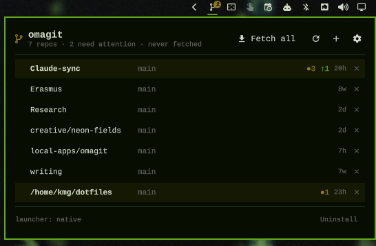
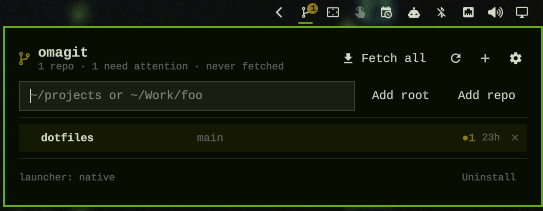
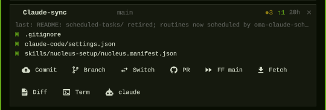

# omagit

Multi-repo git dashboard for the [Omarchy](https://omarchy.org) bar. Track scan
roots (every git repo found under them) and individual repos; see branch, dirty
count, ahead/behind, open PRs with CI color, and last-commit age on one line
each; read your GitHub inbox (notifications, review requests, your PRs, assigned
issues, Actions runs) in a second tab; and do the housekeeping — quick commit, branch ops, create/merge PR,
fast-forward main, prune gone branches, open a terminal or your default coding
agent — without leaving the bar.

Local state is live (inotify-driven, fallback timer). A background fetch
(every `autoFetchMinutes`, default 30) only updates remote-tracking refs and
reads GitHub; nothing touches a working tree unless you press a button or key.

<p align="center">
  
</p>

## Install

```bash
omarchy plugin add https://github.com/gumbledore/omagit.git --enable
```

Or by hand: clone anywhere and symlink it in (this is also the dev setup —
edits are picked up by the shell):

```bash
git clone https://github.com/gumbledore/omagit.git ~/projects/omagit
ln -sfn ~/projects/omagit ~/.config/omarchy/plugins/gumbledore.omagit
omarchy plugin enable gumbledore.omagit right
```

If the shell keeps showing old QML after an edit, clear its compile cache and
restart: `rm -rf ~/.cache/quickshell/qmlcache && omarchy-restart-shell`.

Requirements (all present on Omarchy): `bash`, `git`, `gh` (logged in for
GitHub repos), `jq`, `inotifywait`. The Inbox needs the `notifications` token
scope, plus `repo` for private repositories:
`gh auth refresh -s notifications,repo`. A banner in the panel says so when gh
is missing, logged out, rate-limited, or lacks the scope. Optional: [herdr](https://herdr.dev) when
`launcher = "herdr"`.

### Keybind

Add to `~/.config/hypr/bindings.conf`:

```
bindd = SUPER CTRL, G, omagit, exec, omarchy-shell omagit toggle
```

IPC target `omagit` also accepts `open`, `close`, `refresh`, and
`expand <label>` (opens the panel with that repo expanded).

## Using it

<p align="center">
  
  <br>
  
</p>

- **Bar icon** — git-branch glyph with a badge counting repos that are dirty,
  ahead, or behind (hidden at zero), plus an accent dot when the inbox has
  unread notifications, review requests, or failing CI on your PRs. Left-click
  toggles the panel, right-click refreshes.
- **Tabs** — Repos and Inbox, each with a count; the last tab is remembered.
- **Header** — Fetch all · Refresh · **+** (add root / add repo, manage roots)
  · settings (opens `settings.json` in the Omarchy default editor). The summary shows
  the repo count, attention count, and when the last fetch ran. Below it, a
  filter field (matches repo labels) and an **Attention** toggle.
- **Rows** — `label  branch  ●dirty  ↑ahead↓behind  PR n  age  ×`. Repos found
  under a root are labeled by their path relative to it
  (`tools/my-repo`); explicit repos by basename. Rows needing
  attention are tinted. Repos without an upstream or remote say so instead of
  erroring. **×** untracks (explicit repo → removed; discovered repo → added
  to `excluded`; nothing on disk changes).
- **Expanded row** (click a row) — dirty files with status letters (click one
  to open it with `openFileCommand`), open PRs (click to open in the browser,
  **Merge** button per PR), and the action strip:
  - **Commit** — inline form: message prefilled from the changed files, target
    branch prefilled `branchPrefix + date` when on main/master (else the current
    branch), and a "Commit to main" toggle. Stages all, commits, pushes with
    upstream. If a push to main is rejected, the commit is moved to a new
    prefixed branch, main is reset to origin, the branch is pushed, and a PR is
    opened with `gh pr create --fill`.
  - **Branch** — new branch from an inline name field. **Switch** — local
    branches as inline buttons.
  - **PR** — refused on main/master; otherwise pushes and opens the PR form in
    the browser (an existing PR is opened instead).
  - **FF main** — fast-forwards the default branch (from `origin/HEAD`) whether
    or not it is checked out; a diverged main is reported and nothing changes.
  - **Fetch** — this repo only. **Diff** — read-only stat + per-file diff inline.
  - **Term** / **agent** — terminal or `omarchy-default-agent` rooted in the
    repo, via the native launchers or herdr (see `launcher`). With no default
    agent set the button says so.
  - **Merge** on a PR runs `gh pr merge --<mergeStrategy>`, switches a clean checkout of the merged branch back to the default branch, deletes the remote
    branch (`deleteBranchOnMerge`), then fast-forwards main and prunes local
    branches whose upstream is gone — removing a clean worktree on that branch
    first; a dirty one is kept and reported.
    A failing-CI PR turns the button red and needs a second click.
  - Every action writes a one-line status; a failed one expands to the captured
    output on click.
- **Inbox tab** — sections for unread notifications, review requests, your
  open PRs (CI dot), assigned issues, and running or recently failed Actions
  runs in tracked repos. Drafts awaiting your review and archived repos are
  hidden; each section shows at most 50 items, and one that failed to fetch
  says so while the others render. The last good snapshot is cached and shown
  at startup. Click or Enter opens the item (a notification is also marked
  read); the check button marks a notification read in place. **Mark all
  read** arms on the first click and confirms on the second; it affects only
  the notifications shown and anything older (never ones that arrived since). Items in a tracked repo carry a marker; on PRs and
  review requests there, **Checkout** runs `gh pr checkout` in the local clone
  (refused when the working tree is dirty); **Open repo** on any tracked item
  jumps to its row.
- **Footer** — Uninstall (arms on first click, confirms on the second within a
  few seconds): removes `~/.config/gumbledore.omagit` and runs
  `omarchy plugin remove gumbledore.omagit --yes`.

### Keys

Shortcuts are off while a text field has focus (Esc leaves the field).

| Key | Action |
|-----|--------|
| `Tab`, `1` / `2` | Switch tab / Repos / Inbox |
| `j` `k`, arrows | Move the highlight |
| `Enter` / `Space` | Expand or collapse the repo row; open the inbox item |
| `r` / `f` | Refresh / Fetch all |
| `Esc` | Close the panel |
| Repos: `/` · `a` | Focus the filter · toggle attention-only |
| Repos, expanded row: `c` `b` `s` `p` `m` `u` `d` `t` `g` | Commit · Branch · Switch · PR · FF main · Fetch · Diff · Term · agent |
| Inbox: `m` | Mark the highlighted notification read |
| Inbox: `c` · `o` | Checkout the PR locally · show the item's repo (tracked repos only) |

### Auto-fetch

Every `autoFetchMinutes` (and once at startup if a fetch is overdue) omagit
runs the same work as **Fetch all**: `git fetch` for each tracked repo — which
only moves remote-tracking refs — plus the PR and inbox lookups. Failures of a
background run stay quiet (the summary line notes them), a GitHub rate limit
pauses fetching until it resets, and a manual fetch never overlaps a running
one. Set `autoFetchMinutes` to `0` to fetch only from the buttons.

## Settings

`~/.config/gumbledore.omagit/settings.json` is created from the shipped defaults the first
time the plugin loads and re-merged on every load: missing keys are added,
your values are never overwritten, and `schemaVersion` is recorded. Edits apply
live. There are no option menus in the panel.

| Key | Default | Meaning |
|-----|---------|---------|
| `schemaVersion` | `1` | Managed by the plugin |
| `launcher` | `"native"` | `"native"` (`xdg-terminal-exec`, `omarchy-agent`) or `"herdr"` (one workspace per repo — Terminal focuses it, each agent click opens a new tab; agent-status dot on rows) |
| `allowMerge` | `true` | Show the Merge button and allow `merge-pr`; set `false` on shared repos where merging should happen through the PR page |
| `mergeStrategy` | `"squash"` | `squash` \| `merge` \| `rebase` |
| `deleteBranchOnMerge` | `true` | Delete the PR's remote branch after merging (local copy is removed by prune) |
| `pruneGoneAfterMerge` | `true` | Delete local branches whose upstream is gone after a merge (a clean worktree on that branch is removed first; a dirty one is kept and reported) |
| `branchPrefix` | `"work/"` | Prefix for suggested branches (`work/2026-08-28`) |
| `fallbackRefreshSeconds` | `300` | Full re-read + root re-scan + watcher restart interval |
| `debounceMs` | `500` | Per-repo debounce for filesystem events |
| `scanDepth` | `4` | How deep a root is scanned for repos |
| `ignoreDirs` | `["node_modules", ".venv", "venv", "dist", "build", "__pycache__", ".obsidian", "target"]` | Never entered during discovery and excluded from the watcher (dotfolders and symlinks are always skipped) |
| `openFileCommand` | `"omarchy-launch-editor"` | Command that receives an absolute path (default: the Omarchy default editor); e.g. `"zeditor"` for Zed |
| `ghPrLimit` | `20` | `--limit` for `gh pr list` |
| `autoFetchMinutes` | `30` | Background fetch interval; `0` turns it off |
| `linkBehavior` | `"browser"` | Where GitHub links open: `"browser"` or `"webapp"` (`omarchy-launch-webapp`) |

Tracking lives in `~/.config/gumbledore.omagit/tracking.json` (`roots`, `repos`,
`excluded`; absolute paths). It is created on the first add.

## Caveats

- **gh credential helper pin.** `gh auth setup-git` writes the helper path with
  the exact mise-installed `gh` version. After a `gh` upgrade, non-TTY pushes
  fail until you rerun `gh auth setup-git`. omagit shows this as a push error.
- Any git repo under a root is discovered, including tooling/config repos you
  may not care about; untrack them (×) if you do not want them listed.
- Zed's binary on Omarchy is `zeditor`; use that as `openFileCommand`.
- Repos whose `origin` is not on github.com skip the PR lookup silently.

## Removing

The in-panel **Uninstall** cleans up everything. If you remove the plugin with
`omarchy plugin remove gumbledore.omagit` or omaplug instead, delete the config yourself:

```bash
rm -rf ~/.config/gumbledore.omagit
```

and drop the keybind from `bindings.conf`.

## Development

```bash
tests/run.sh                      # helper tests against fixture repos; no shell, no network
omarchy plugin validate "$PWD"    # manifest check (real path, not the symlink)
```

All git/gh/herdr logic lives in `bin/` and is exercised by `tests/` with stub
`gh`/`herdr`/launchers on `PATH`; QML only renders records. See `CLAUDE.md`.

## Credits

The inbox borrows ideas from
[robzolkos/omarchy-github](https://github.com/robzolkos/omarchy-github) (MIT):
the shape of the GraphQL inbox query and the mark-all-read boundary technique.
No code is vendored.

## License

[MIT](LICENSE).
